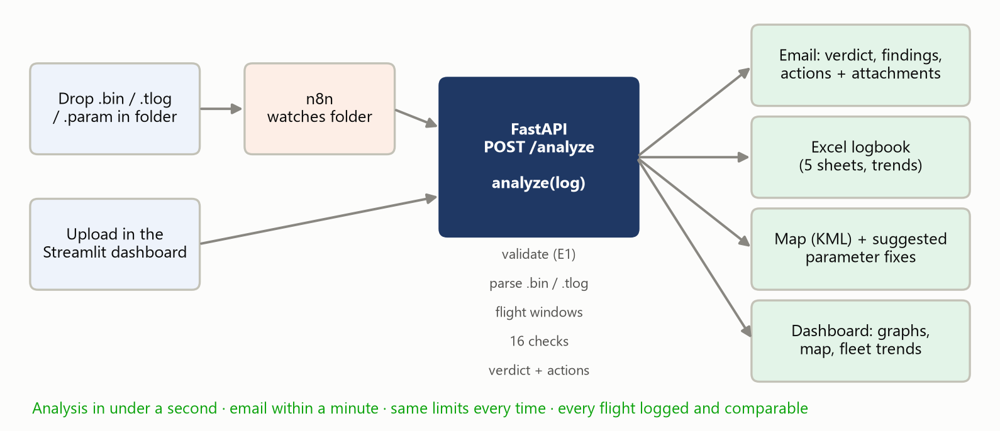
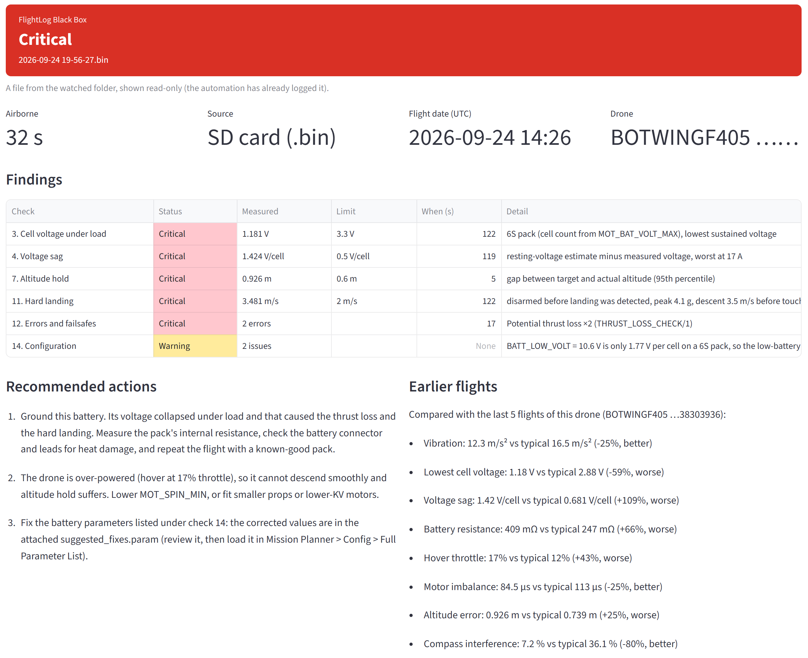
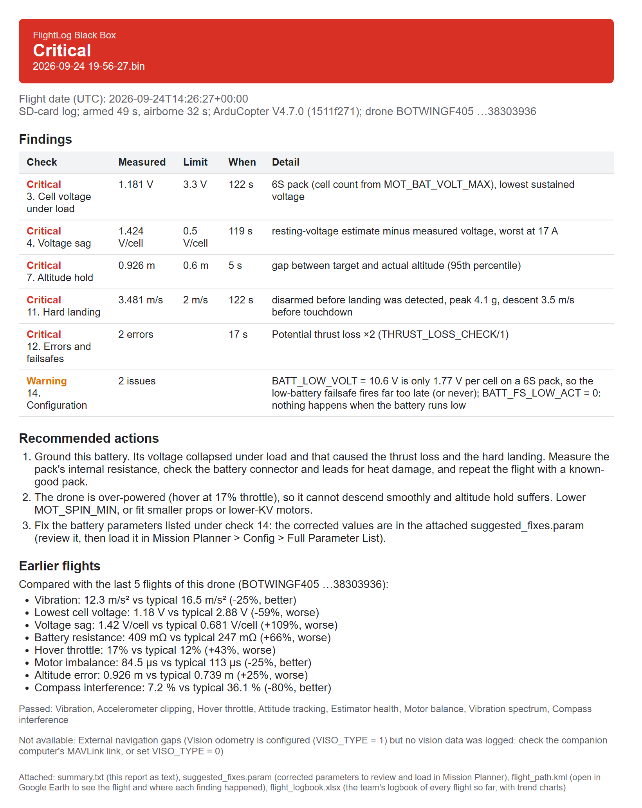
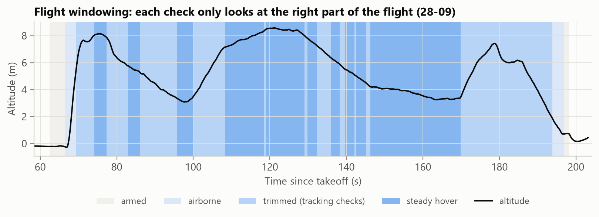
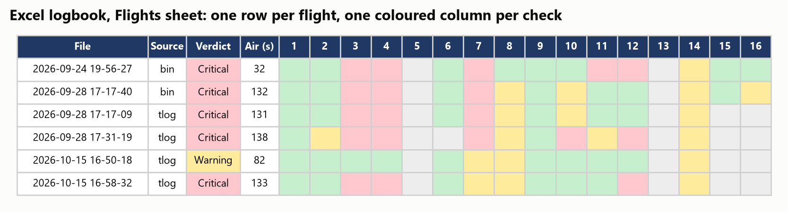
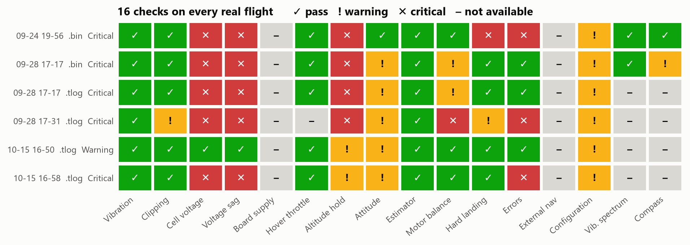
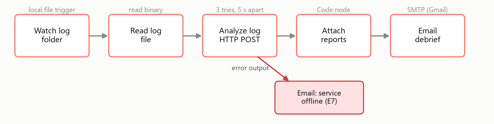

# FlightLog Black Box

**Automated health checks for ArduPilot drone flight logs.** Drop a log into a folder and, within a minute,
the team gets an email with a Healthy / Warning / Critical verdict, the reasons, what to fix, and an updated
logbook of every flight. Nobody has to open a graph.



Built for the CA3 Software Automation Lab around the drone our team flies for NIDAR.

---

## Why

After every test flight, someone used to open the log in Mission Planner or UAV Log Viewer, click through
vibration, battery, estimator and motor graphs, and decide by eye whether the drone was fit to fly again.
That review was slow, depended on who was looking, used no fixed limits and left no record, so problems that
build up over several flights (a loosening prop, an ageing battery) went unnoticed.

## What it does

- **16 health checks** on every flight, each against a limit in [`thresholds.yaml`](thresholds.yaml).
- **A verdict with reasons:** every finding has the measured value, the limit, when it happened and what to do.
- **Suggested fixes:** a Mission Planner `.param` file with corrected values, ready to review and load.
- **Pre-flight GO / NO-GO:** drop the drone's parameter file in before flying.
- **Fleet history:** an Excel logbook, trends across flights, and a comparison with the same drone's earlier
  flights.
- **Tamper-evident ledger:** a hash chain over every processed file, so past verdicts can't be quietly edited.
- **Hands-free:** n8n watches the folder and emails the team; a Streamlit dashboard shows the same results.

<p align="center">
  
  
</p>

## Quick start

Windows, Python 3.11+ and Node.js (for n8n).

```bash
py -3.11 -m venv .venv
.venv\Scripts\python -m pip install -r requirements.txt
```

Check a log straight away, no email or n8n needed:

```bash
.venv\Scripts\python -X utf8 -m blackbox path\to\flight.bin
```

For the full automation, set up email once. It asks for your Gmail address, who should get the emails and a
[Gmail App Password](https://myaccount.google.com/apppasswords), then imports and switches on the n8n workflow:

```bash
.venv\Scripts\python scripts\setup_n8n.py
```

Then, every time:

```bash
powershell -ExecutionPolicy Bypass -File scripts\start.ps1
```

This opens three windows: the API, n8n and the dashboard (http://localhost:8501). Wait until n8n has started
(a few minutes on the first run), then drop a `.bin`, `.tlog` or `.param` into `flight-logs\` or upload it on
the dashboard. Close the three windows to stop.

New to the project? [PROJECT_GUIDE.md](PROJECT_GUIDE.md) walks through everything step by step.

## How it works

One Python function, `analyze(log_path)`, does all the work. n8n and the dashboard are two ways of calling it,
so a folder drop and an upload always give the same result.

1. **Validate.** The file type is read from its bytes, not its name, so a renamed photo is rejected and a log
   saved without its extension still works.
2. **Parse.** `.bin` logs are read with pymavlink; `.tlog` messages are mapped onto the same tables.
3. **Split into flight windows:** armed, airborne, steady hover, and airborne minus the takeoff and landing
   transients. Bench time and transients would otherwise raise false alarms.
4. **Run the 16 checks,** each only in its own window and per sensor (several IMUs, batteries or EKF cores are
   checked separately and the worst is reported).
5. **Decide:** any Critical makes the flight Critical, any Warning makes it Warning, otherwise Healthy. A check
   whose data is missing shows Not available and doesn't count.
6. **Advise:** linked causes first (a collapsing battery explains the thrust loss and the hard landing), then
   one action per finding, the `.param` fixes and the map.



### Log types

| File | Source | Result |
|---|---|---|
| `.bin` | DataFlash log from the SD card | Full analysis |
| `.tlog` | Ground-station telemetry (Mission Planner) | Analysed with reduced detail |
| `.rlog` | Raw radio capture, no timestamps | Rejected, with what to upload instead |
| `.param` | Parameter list from Mission Planner or QGroundControl | Pre-flight GO / NO-GO |

Telemetry arrives at only 2–4 Hz, so spikes shorter than about a second can be missed, the hard-landing check
uses descent rate only, and errors come from STATUSTEXT messages instead of ERR records.

### The 16 checks

| # | Check | Warning / Critical |
|---|---|---|
| 1 | Vibration (VIBE X/Y/Z, sustained) | > 30 / > 60 m/s² |
| 2 | Accelerometer clipping while airborne | > 0 / > 100 |
| 3 | Cell voltage under load | < 3.5 / < 3.3 V |
| 4 | Voltage sag per cell | > 0.3 / > 0.5 V |
| 5 | Board supply (POWR.Vcc) | < 4.8 / < 4.5 V |
| 6 | Hover throttle | > 0.60 / > 0.75 |
| 7 | Altitude hold, 95th-percentile error | > 0.3 / > 0.6 m |
| 8 | Attitude tracking, 95th-percentile error | > 5 / > 10° |
| 9 | Estimator (EKF test ratio held 1 s) | > 0.8 / > 1.0 |
| 10 | Motor balance, worst 5 s | > 100 / > 200 µs |
| 11 | Hard landing (impact, descent rate) | > 3 g or 1 m/s / > 5 g or 2 m/s |
| 12 | Errors and failsafes while armed | any / crash, EKF, thrust loss |
| 13 | External navigation gaps | > 0.2 / > 0.5 s |
| 14 | Battery settings against the pack fitted | mismatch: Warning |
| 15 | Vibration spectrum (FFT) against the notch filter | peak missed: Warning |
| 16 | Compass interference from battery current | > 30 / > 60 % |

Vibration, EKF and compass limits follow the ArduPilot documentation; the rest are team-set starting values,
to be tuned on two or three clean flights.

### What the team receives

- **The email:** verdict banner, findings table, recommended actions, comparison with this drone's last five
  flights, and what passed or wasn't available. HTML with a plain-text copy.
- **`suggested_fixes.param`:** corrected parameters, each with its reason. Review before loading.
- **`flight_path.kml`:** the flight in Google Earth, with each finding pinned where it happened (GPS logs only).
- **`flight_logbook.xlsx`:** sheets Flights, Findings, Exceptions, Pre-flight and Trends. It's rebuilt from
  `output/logbook.jsonl` on every save, because openpyxl drops charts when it edits a workbook.



The dashboard's **Analyse a log** tab shows the same report with graphs and a map. Uploads go into the watched
folder when n8n is running, so they're logged and emailed like any dropped file. The **Fleet logbook** tab
shows every flight, trends across flights, exceptions, pre-flight checks and the ledger status.

## Exception handling

| | Scenario | What happens |
|---|---|---|
| E1 | Not a flight log | Rejected; the email says why |
| E2 | Corrupt or truncated log | Analysed and marked Incomplete; rejected if under 30 s of flight remains |
| E3 | Message types missing | That check is Not available, with the logging option to enable |
| E4 | Same file uploaded again | Analysed again with a note, counted once (matched by SHA-256) |
| E5 | Bench log, never armed | Classed No flight |
| E6 | Logbook open in Excel | 3 tries, 10 s apart, then `flight_logbook_pending.xlsx` |
| E7 | Analysis service down | n8n tries 3 times, then emails "service offline" |

## Results on our real logs

28 files from our quadcopter: 3 `.bin`, 13 `.tlog` and 12 `.rlog`. Six flight logs were analysed (5 Critical,
1 Warning), nine telemetry logs were ground sessions, and the `.rlog` files were rejected. The main problems
were the battery and its settings: the low-battery failsafe was set far too low on every flight.



## Use it from Python

```python
from blackbox import analyze

res = analyze("flight.bin")
res.status      # Analysed / Rejected / No flight / Pre-flight check
res.verdict     # Healthy / Warning / Critical (GO / GO with warnings / NO-GO for .param files)
res.findings    # Warning and Critical checks, Critical first
res.actions     # recommended actions, most important first
res.to_dict()   # JSON-ready
```

## API

```bash
.venv\Scripts\python -m uvicorn api:app --host 127.0.0.1 --port 8000
```

| Endpoint | Does |
|---|---|
| `POST /analyze` | Upload a log (multipart field `file`). Returns the verdict, the email text, file links and the full result; `?inline=true` adds the attachments base64-encoded. |
| `GET /files/{flight_id}/{name}` | Download one report file. |
| `GET /logbook` | Download the Excel logbook. |
| `GET /ledger` | Recompute the hash chain and report whether it is intact. |
| `GET /health` | Liveness check. |

Requests are serialised by a file lock, so two copies of one log uploaded together count once. Results go to
`output/` (set `FLIGHTLOG_OUTPUT_DIR` to move it).

## n8n workflow



[`n8n/flightlog_workflow.json`](n8n/flightlog_workflow.json) is a template that `setup_n8n.py` fills in with
your folder, API address and email addresses. n8n runs through `npx` (nothing is installed globally) and keeps
its data in `%USERPROFILE%\.n8n`; the Gmail App Password is stored there, encrypted, and never in this
repository.

Things that matter on Windows:

- `start.ps1` enables n8n's folder-watch node, which n8n 2.x disables by default, and limits n8n's file access to
  the watched folder. Command execution stays disabled.
- The watcher polls and waits for writes to finish, so a file still being copied isn't read half-written.
- The API address is `http://127.0.0.1:8000`, not `localhost`: Node 24 resolves `localhost` to IPv6 `::1`.

The older Google Drive version is kept as `n8n/flightlog_workflow_gdrive.json`.

## Tests

```bash
.venv\Scripts\python -m pytest -q
```

88 tests: 83 run on synthetic DataFlash and telemetry logs written by [`tests/dflog.py`](tests/dflog.py) and
`tests/tlogsim.py`, so fault scenarios (a weak motor, a sagging battery, a truncated log) need no drone. The other
5 run when real logs are placed in `tests/data/` as `T1_clean.bin`, `T2_vibration.bin`, `T3_battery.bin` and
`T4_motor_fail.bin`.

## Project layout

```
blackbox/           the analysis package
  validate.py         file type by content (E1) and SHA-256
  parse.py, tlog.py   .bin and .tlog into the same tables
  windows.py          armed / airborne / hover windows
  checks.py           the 16 checks
  pipeline.py         analyze(): validate, parse, check, verdict
  advice.py           recommended actions
  preflight.py        GO / NO-GO from a .param file
  exports.py          .param fixes and KML map
  history.py          comparison with earlier flights
  report.py           email and summary text
  logbook.py          Excel logbook
api.py              FastAPI service
app.py              Streamlit dashboard
n8n/                workflow template and validator
scripts/            setup_n8n.py, start.ps1
tests/              pytest suite and synthetic log writers
docs/               presentation, LaTeX report and figures
thresholds.yaml     every limit
```

## Design notes

- **Parsing** opens `DFReader_binary` directly: `mavutil.mavlink_connection` picks its reader by file extension
  and would misread an upload saved under a temporary name.
- **Cell count** defaults to `auto`: it reads `MOT_BAT_VOLT_MAX` unless that disagrees with the voltage at
  arming (our logs had a 6S setting on a 3S pack). Pin it in `thresholds.yaml` once you know the pack.
- **Check 4** uses ArduPilot's resting-voltage estimate (`VoltR - Volt`) on `.bin` logs.
- **Check 6** uses the median throttle output in hover, because ArduPilot caps the learned `ThH` at 0.6875.
- **Check 10** reads motor channels from `SERVOn_FUNCTION` and uses the worst 5 s chunk, so a motor that fails
  mid-flight isn't averaged away.
- **Check 11** looks at touchdown, not "5 s before disarm", which with the default `DISARM_DELAY` is on the ground.
- **Check 12** ignores resolved errors and errors raised before arming or after disarming.
- **E2** is detected by a log that ends while armed or skipped corrupt bytes, because a cut-off file doesn't
  raise an error.

## Limitations and next steps

- Reads ArduPilot logs only; PX4 `.ulg` support would be next.
- Team-set limits need tuning per airframe.
- Recommendations are rules: they link only the causes they were written for.
- Planned: a PowerPoint debrief per flight, ESC telemetry checks, and anomaly detection once there are enough
  healthy flights to learn from.

## Presentation and report

[`docs/`](docs) has the presentation (`FlightLog_Black_Box.pptx`), the LaTeX report
([`docs/report/report.tex`](docs/report/report.tex)) and the figures they use, all drawn from the real logs.
[`docs/README.md`](docs/README.md) explains how to rebuild them.
